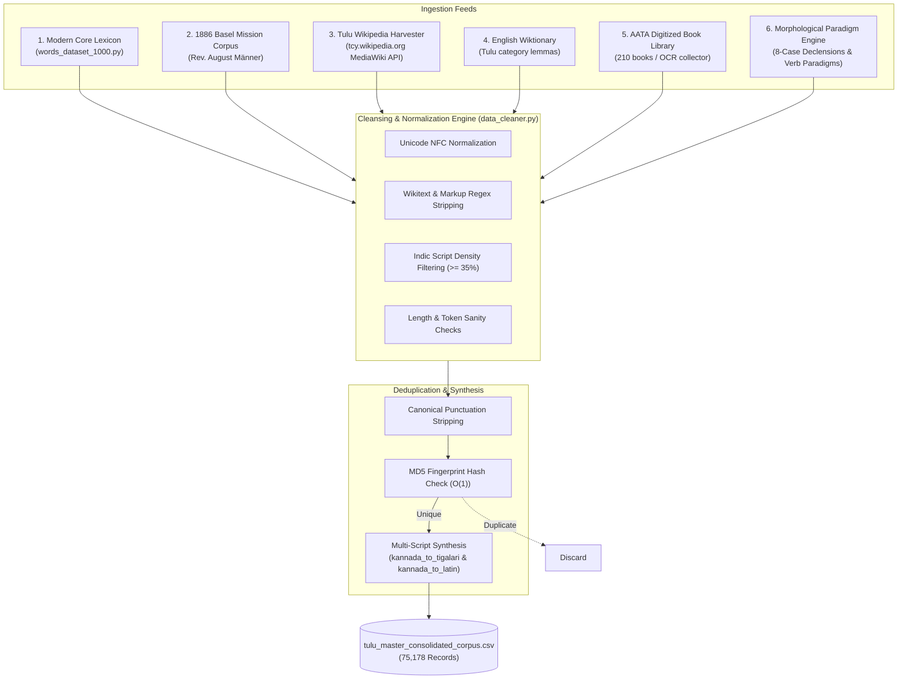

# Tulu Master Consolidated Corpus: Engineering & Creation Guide
*A comprehensive breakdown of how `tulu_master_consolidated_corpus.csv` (75,178 records) was designed, harvested, sanitized, and synthesized.*

---

## 1. Executive Overview

[`tulu_master_consolidated_corpus.csv`](file:///Users/jayanthanayak/Side_task/Tulu_Model/datasets/tulu_master_consolidated_corpus.csv) is the master multi-script ground-truth dataset powering the Tulu-Tigalari Natural Language Processing (NLP) ecosystem, including:
- **Speech-to-Text (ASR)** acoustic alignment and vocabulary priming.
- **Neural Machine Translation (NMT)** parallel sequence-to-sequence translation.
- **Full-Sentence Grammar Syntax Engine** (SOV $\rightleftharpoons$ SVO reordering).
- **Unicode 16.0 Tigalari Transliteration** validation.

Every record is canonicalized across **three scripts** (Kannada script, official Unicode 16.0 Tigalari script, and ITRANS/Baraha phonetic Latin) alongside grammatical and semantic metadata.

```
Total Records  : 75,178 unique sentences & lexical entries
Scripts Synced : 3 (Kannada U+0C80–U+0CFF, Tigalari U+11380–U+113FF, Latin ASCII)
Storage Format : Standardized CSV (UTF-8)
Deduplication  : O(1) MD5 Canonical Fingerprinting
```

---

## 2. Dataset Schema & Column Specifications

| Column Name | Type | Description | Example |
| :--- | :--- | :--- | :--- |
| `id` | Integer | Unique sequential record identifier | `1` |
| `corpus_source` | String | Origin harvester or physical collection | `Lexicon 1000`, `Wikipedia`, `Historical 1886` |
| `category_or_domain` | String | Semantic domain, grammatical role, or source title | `Greetings & Pleasantries`, `Flora & Fauna` |
| `tulu_kannada` | String | Tulu text in contemporary Kannada orthography | `ಸೊಲ್ಮೆಲು` |
| `tulu_tigalari` | String | Official Unicode 16.0 Tigalari script representation | `𑎱𑏆𑎭𑏐𑎪𑏁𑎭𑎻` |
| `tulu_latin` | String | Standardized ITRANS/Baraha phonetic transliteration | `solmelu` |
| `english_translation`| String | Human-verified English meaning or sentence gloss | `Thank you / Greetings (Tulu)` |

---

## 3. Data Ingestion Architecture

The corpus integrates six distinct linguistic feeds:



---

## 4. Source Breakdown & Distribution

```
Breakdown of Records by Origin:
══════════════════════════════════════════════════════════
1. Morphological Paradigms & Grammar Inflections : 59,479
2. Tulu Wikipedia (tcy.wikipedia.org)            : 13,929
3. Native Core Lexicon (1,000 Dataset)           :    971
4. English Wiktionary Category Lemmas            :    349
5. AATA Digitized Book Library (Abbakka)         :    270
6. 1886 Basel Mission Historical Dictionary      :    112
7. AATA Digitized Book Library (Sodara)          :     68
──────────────────────────────────────────────────────────
Total Clean, Deduplicated Records                : 75,178
```

---

## 5. The Engineering Pipeline

### Stage 1: Autonomous Web Harvesting
The scraping was orchestrated by [`ContinuousCorpusHarvester`](file:///Users/jayanthanayak/Side_task/Tulu_Model/kannada_tigalari_converter/scrapers/continuous_scraper.py):
- **API Target**: `https://tcy.wikipedia.org/w/api.php`
- **Pagination**: Utilizes MediaWiki's `allpages` API with `apcontinue` pagination tokens.
- **Batching**: Pages are requested in chunks of 20 to respect server limits without triggering rate-limiting.
- **Checkpointing**: Every iteration records the continuation token to [`.scraper_checkpoint.json`](file:///Users/jayanthanayak/Side_task/Tulu_Model/datasets/.scraper_checkpoint.json), allowing pause (Ctrl+C) and resume without re-scraping existing pages.

### Stage 2: Data Cleansing & Linguistic Normalization
Raw scraped wikitext is processed by [`DataCleaner`](file:///Users/jayanthanayak/Side_task/Tulu_Model/kannada_tigalari_converter/scrapers/data_cleaner.py):
1. **Unicode NFC Normalization**:
   Applies `unicodedata.normalize("NFC", text)` and removes invisible zero-width spaces (`\u200b`–`\u200f`), byte-order marks (`\ufeff`), and bidirectional controls (`CONTROL_CHARS_RE`).
2. **Noise & Markup Stripping**:
   - Removes templates: `\{\{[^}]*\}\}`
   - Strips footnotes and references: `<ref[^>]*>.*?</ref>`
   - Unpacks internal links: `\[\[(?:[^|\]]*\|)?([^\]]+)\]\]` $\rightarrow$ Target Text
   - Strips headers, edit tags, and citation brackets: `\[\d+\]`, `\[citation needed\]`
   - Strips URLs and image markers (`File:`, `Image:`, `ಚಿತ್ರ:`).
3. **Indic / Kannada Script Density Filtering**:
   Validates that the content is genuinely written in Kannada/Tulu orthography rather than English boilerplate:
   $$\text{Kannada Density} = \frac{\text{Count of Kannada Unicode Codepoints (U+0C80–U+0CFF)}}{\text{Total Characters}} \ge 35\%$$
4. **Length Bounds**:
   Requires a minimum of 2–3 words and at least 4–8 characters to reject broken tokens or trailing punctuation.

### Stage 3: $O(1)$ Canonical Fingerprint Deduplication
To eliminate exact and near-exact duplicates across overlapping articles and book editions, [`DeduplicatedDataset`](file:///Users/jayanthanayak/Side_task/Tulu_Model/kannada_tigalari_converter/scrapers/data_cleaner.py) computes a canonical MD5 hash for every candidate sentence:

```python
# Strip all punctuation, whitespace, and case variants
canonical = re.sub(r"[\s\.,?!:;\"\'`\(\)\[\]\{\}«»—–\-_/\\|।॥]+", "", cleaned_text.lower())
fingerprint = hashlib.md5(canonical.encode("utf-8")).hexdigest()

if fingerprint in self.seen_fingerprints or cleaned_text in self.seen_exact:
    # Discard duplicate in O(1) time
    return False, "duplicate"
```

### Stage 4: Multi-Script Synthesis
When sentences originate from Wikipedia or AATA books, only the Kannada script (`tulu_kannada`) is natively present. The pipeline synthesizes the missing scripts on insert:
- **Tigalari**: Evaluates [`kannada_to_tigalari()`](file:///Users/jayanthanayak/Side_task/Tulu_Model/kannada_tigalari_converter/core/kannada_tigalari.py) to generate Unicode 16.0 Tigalari aksharas (`U+11380`–`U+113FF`).
- **Phonetic Latin**: Evaluates [`kannada_to_latin()`](file:///Users/jayanthanayak/Side_task/Tulu_Model/kannada_tigalari_converter/core/tulu_phonetic.py) to generate unambiguous ITRANS/Baraha phonetics.

### Stage 5: Systematic Morphological Expansion
To ensure complete coverage of grammatical forms, [`tulu_morphology.py`](file:///Users/jayanthanayak/Side_task/Tulu_Model/kannada_tigalari_converter/nlp/tulu_morphology.py) systematically declines nouns and conjugates verbs:
- **Nouns**: Declines stems across all 8 Dravidian grammatical cases:
  1. *Nominative* (ಪ್ರಥಮಾ - Base)
  2. *Accusative* (ದ್ವಿತೀಯಾ - `ನ್` / `in`)
  3. *Instrumental* (ತೃತೀಯಾ - `ಡ್ದ್` / `ddu`)
  4. *Dative* (ಚತುರ್ಥೀ - `ಗ್` / `kku`)
  5. *Ablative* (ಪಂಚಮೀ - `ರ್ದ್` / `rdu`)
  6. *Genitive* (ಷಷ್ಠೀ - `ದ` / `da`)
  7. *Locative* (ಸಪ್ತಮೀ - `ಡ್` / `du`)
  8. *Vocative* (ಸಂಬೋಧನಾ - `ಏ` / `e`)
- **Verbs**: Expands stems across Present, Past, Future, Negative, Potential, Gerund, and Imperative forms with 1st, 2nd, and 3rd person singular/plural and honorific agreements.

---

## 6. How to Inspect or Re-generate the Dataset

### Quick Inspection Command
```bash
python3 -c "
import csv
with open('datasets/tulu_master_consolidated_corpus.csv', 'r', encoding='utf-8') as f:
    reader = csv.DictReader(f)
    print('Fieldnames:', reader.fieldnames)
    first_row = next(reader)
    for k, v in first_row.items():
        print(f'  {k}: {v}')
"
```

### Export Dataset from CLI
```bash
# Export all sub-datasets and master corpus to datasets/
python3 kannada_tigalari_converter/cli.py --export-csv

# Run the autonomous scraper to harvest more records
python3 kannada_tigalari_converter/cli.py --scrape-continuous --target 100000
```
